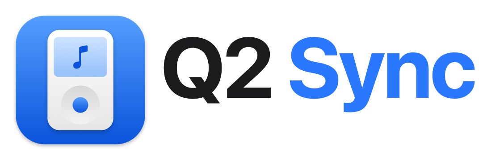
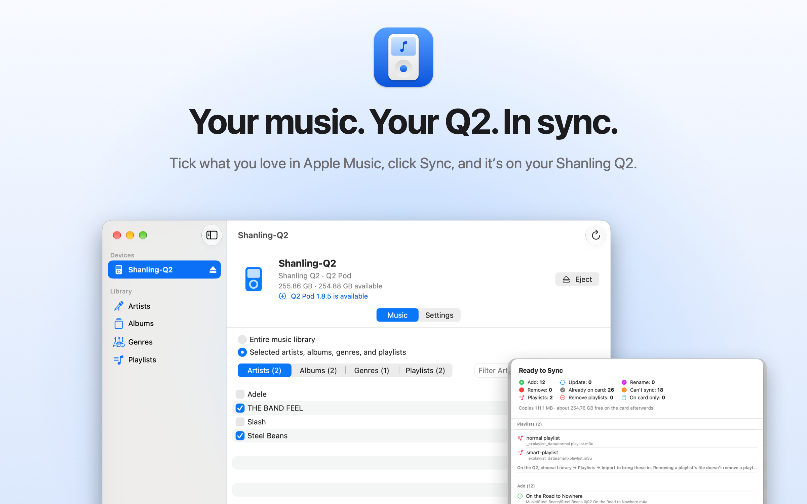
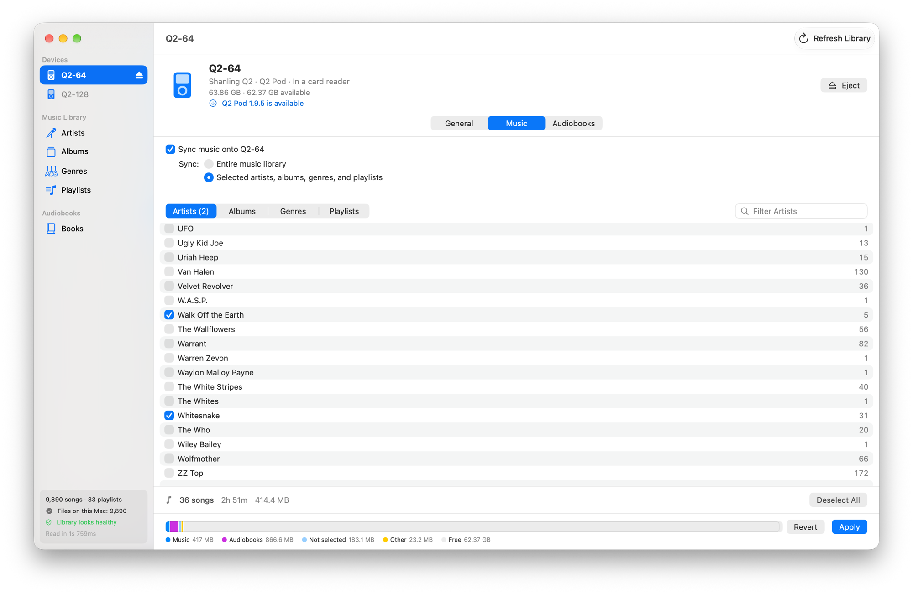
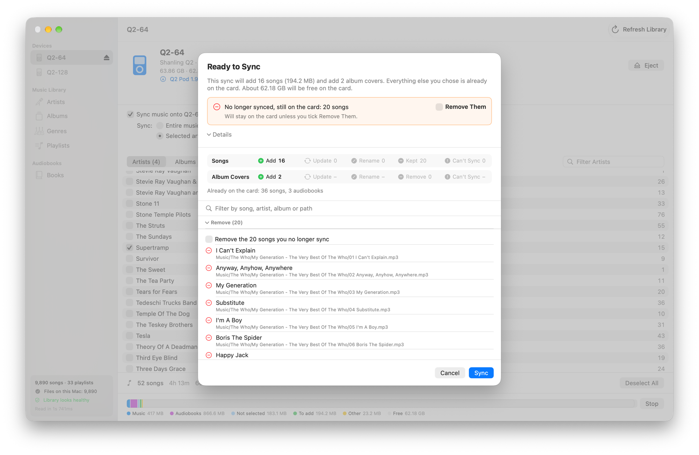
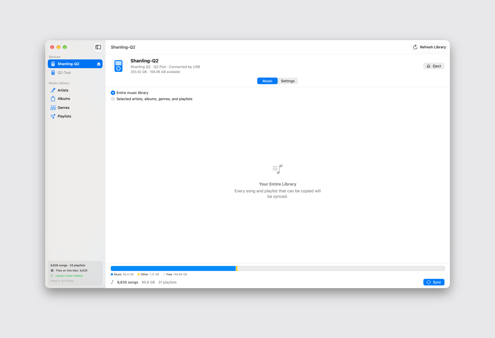
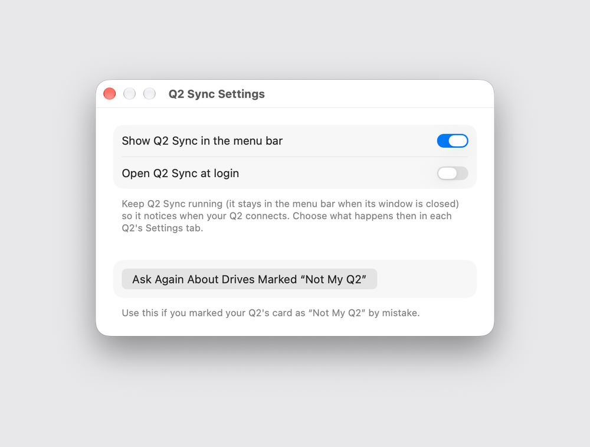

<p align="center">
  <picture>
    <source media="(prefers-color-scheme: dark)" srcset="docs/images/logo-dark.png">
    
  </picture>
</p>

<p align="center">
  <b>Sync the music files in your Mac's Music app to a Shanling Q2, the way Finder syncs an iPod.</b>
</p>

<p align="center">
  Your own MP3, AAC, Apple Lossless, WAV and AIFF files · Not Apple Music subscription streams or downloads
</p>

<p align="center">
  
  
  
  <a href="LICENSE"></a>
</p>

<p align="center">
  
</p>

> [!IMPORTANT]
> **Q2 Sync copies music files you own, not the Apple Music subscription.**
> It syncs songs stored as **local, DRM-free files** in the Music app's
> library: music you've ripped from CDs, bought from the iTunes Store
> (DRM-free since 2009), downloaded from Bandcamp or elsewhere, or added
> yourself, in formats like MP3, AAC, Apple Lossless (ALAC), WAV and AIFF.
> Songs from an **Apple Music subscription can't be synced**, even when
> they're downloaded for offline listening: Apple protects them with DRM
> so they only play inside Apple's apps. Songs that are only in iCloud
> (not downloaded to your Mac) are skipped too. Q2 Sync lists all of these
> under "can't be synced" so you always know what's left out.

---

Remember plugging in an iPod? It showed up in the sidebar, you ticked the
music you wanted, clicked **Sync**, and that was it. Everything just stayed
up to date.

The Shanling Q2 is a wonderful little player, but on a Mac it's just a drive.
No sidebar, no sync, no playlists. **Q2 Sync brings that iPod experience back** for
the music collection you keep in the Music app. Your Q2 appears in its own
window the moment you plug it in. Choose your artists, albums, genres and
playlists, preview exactly what will change, and
click Sync. Next time, only what's new is copied.

Plenty of us still keep a carefully built library in the Music app, the one
place that syncs to an iPhone, an iPod, and everything else. Moving to
another player shouldn't mean giving that up. Q2 Sync treats your Music
library as the source of truth and keeps your Q2 matching it, so the Q2
simply becomes one more device your library syncs to.

It's a native Mac app built with SwiftUI, and it's built to feel like part of
macOS: a sidebar and detail layout, SF Symbols, a menu bar item, notifications,
and light and dark mode.

## Highlights

### 🎵 Pick your music, the familiar way
Sync your **entire library** of local music files, or tick exactly the **artists, albums, genres and
playlists** you want. Add a new album by an artist you've ticked, and it
syncs on its own.

### 🔎 Browse your library against your Q2
The **Music Library** browser marks what's on your Q2, what the next sync adds
and what can't be copied, even with the Q2 unplugged. Double-click a song or
press **⌘I** to open **Song Info**: its artwork, tags, file details and plays,
with **Show in Finder**.

### 👀 See every change before it happens
The **Ready to Sync** preview lists every song that will be added, updated,
renamed or removed, and how much space is left afterwards. Nothing changes
until you click **Sync** on it.

### ⚡️ Fast, incremental syncs
Only new or changed songs are copied. Retag a song in Apple Music and it's
renamed on the card instead of copied again. A **time remaining** estimate
keeps you posted.

### 📋 Playlists that actually make it
Regular playlists, smart playlists and Genius playlists are written for the
Q2's **Library → Playlists → Import**. By default every playlist stays in the
import folder, so none can miss an Import. If Import is slow for you, turn on
**Only put new or changed playlists in the import folder**: the sync window
then asks whether you imported the last batch before taking any out.

### 📊 A capacity bar you'll recognize
Music, files not from Q2 Sync, what this sync adds, and free space, all at a
glance, with a warning when your selection won't fit.

### 🔌 Plug in and forget
**Auto-sync** when your Q2 connects (or ask first), notifications when it's
done (with Eject and Verify Card), a menu bar item (the Dock icon hides while the window is
closed), and an option to open at
login (in Settings, and suggested when you turn on auto-sync).

### 👋 Easy to start
A **Connect Your Q2** page walks you through USB Storage mode, and music you
already copied to the card by hand is recognized instead of copied twice.

### 🖼️ Album covers
A `cover.jpg` in each album folder (on by default), made from Apple Music's
artwork, so the Q2 shows covers even for songs without embedded art. Turn it
off and they're removed again. Your own cover files are never touched.

### 🛠️ Firmware, handled
Install, update or switch between **[Q2 Pod](https://github.com/DiamondBond/q2-pod)**
custom firmware and Shanling's stock firmware. Q2 Sync downloads the latest
version, checks that it's genuine Q2 firmware (and matches GitHub's checksum
for Q2 Pod), copies it to the card and walks you through the update on the Q2.

### 🧰 Card tools
**Verify Card** compares every song with your Mac's copy, byte for byte, and
re-copies anything damaged. **Back up and restore Q2 Pod's data** (ratings,
unsent scrobbles, EQ presets, radio favorites and settings). *Backup and
restore are covered by unit tests but haven't been tested on a real Q2 yet, so
treat them as experimental and report anything odd.* Music that's only
on the card is never removed without asking: keep it, move it back to
your Mac, or delete it.

## A closer look

| | |
| --- | --- |
|  |  |
| *Choose artists, albums, genres and playlists* | *Preview every change before it happens* |
|  |  |
| *Finder-style capacity bar* | *Menu bar item and open at login* |

## Safe by design

Q2 Sync was built so that the worst thing that can go wrong is a bad sync to
the card, which you fix by syncing again.

- **Read-only toward Apple Music.** The library is read with Apple's
  `iTunesLibrary` framework, which can't change it. The App Sandbox gives the
  app **read-only** access to `~/Music`, so macOS itself blocks any write
  there. Song files are opened read-only.
- **One path guard.** Every change on the card passes a single checker that
  refuses anything outside the confirmed card, on the wrong or an internal
  disk, inside your Music folder, or on the list of firmware files. It has
  two narrow exceptions, each used only when you ask: `update.tar` at the
  card root (Install Firmware), and the fixed list of Q2 Pod's data files
  (Restore Q2 Pod Data).
- **Your card is recognized by its unique ID**, which you confirm once, so
  another drive is never mistaken for it.
- **"Mac looks empty" guard.** If the library can't be read or your music drive
  is disconnected, the sync stops before touching the card.
- **Firmware only when you ask.** Firmware is downloaded only when you click
  Install or Update, and checked before and after it's copied to the card.
  Q2 Sync never flashes the Q2 itself: the Q2's own updater does that when
  you choose **TF card update**.
- **Nothing is removed without asking.** Removals are off by default, and
  removing more than 20% needs extra confirmation. Music that's only on the
  card can be moved to your Mac before it leaves the card.
- **Private.** The only network access is for firmware (GitHub, and
  Shanling's download page for stock firmware). Nothing about you or your
  library is ever sent anywhere.
- **Keep a backup of your Mac.** Q2 Sync can back up Q2 Pod's data on the
  card, but it doesn't back up your Mac: please use Time Machine or another
  backup, as always.

## Requirements

- macOS 27.2 or later
- Xcode 27.2 or later (to build)
- A Shanling Q2 with a microSD card formatted **exFAT** or **FAT32** as one
  volume on a Master Boot Record partition table, set to
  **USB Storage** in its quick-access menu (or the card in a card reader)
- Music stored as **local, DRM-free files** in the Music app (MP3, AAC,
  Apple Lossless, WAV, AIFF). Apple Music subscription songs (DRM-protected,
  even when downloaded), older protected iTunes Store purchases, and songs
  only in iCloud are listed but can't be copied. Files are copied as they
  are, without converting.

## Install

**Download:** get the latest `Q2-Sync-<version>.zip` from
[Releases](https://github.com/PaleoLabs/Q2-Sync/releases), unzip it and drag
**Q2 Sync** to your Applications folder. It's signed and notarized by Apple.
Each release lists a SHA-256 checksum to check the download against.
What changed in each build is in [CHANGELOG.md](CHANGELOG.md).

**Or build it yourself:**

1. Clone this repository.
2. In Terminal, from the repository folder, run:

   ```bash
   Scripts/install.sh
   ```

   It builds the Release version and installs **Q2 Sync** in your
   Applications folder (replacing an older copy). Run it again after updating
   the code.
   **Q2 Sync › About Q2 Sync** shows which build you have, e.g.
   `Version 0.1 (142 · 0e7d893)`: the build number counts git commits, and
   the hash says which one (`-dirty` means uncommitted changes). The script
   prints the same line when it finishes.

To work on the app instead, open `Q2-Sync.xcodeproj` in Xcode, select the
**Q2-Sync** scheme and **My Mac**, and press **⌘R**.

The project signs locally ("Sign to Run Locally"), which is enough to run it
on your own Mac. To share builds, set your Apple Developer team in the target's
**Signing & Capabilities**.

Run the unit tests from the repository root:

```bash
swift test
```

New to the app? Read the [User Guide](docs/USER_GUIDE.md), also in the app under
**Help › Q2 Sync Help**. Want to work on the code? Start with the
[Code Guide](docs/CODE_GUIDE.md) and [Contributing](CONTRIBUTING.md).

## Firmware compatibility

| | Q2 Pod (custom) | Shanling stock |
| --- | --- | --- |
| Syncing music | ✅ | ✅ |
| Playlists (`_explaylist_data/*.m3u`) | ✅ confirmed on Q2 Pod 1.8.9 | ✅ same folder, to verify on device |
| Album covers (`cover.jpg`, optional) | ✅ Cover Flow and Library (refresh Cover Flow after changes) | ✅ Now Playing and Album Wall (to verify on device) |
| "Update the library on your Q2" steps | Library → Update Library → Scan music now | Local Songs → Update Library → Scan music now |
| Install / switch firmware | ✅ latest GitHub release (checksum-verified) | ✅ latest from Shanling's download page |
| Firmware update notices | ✅ from GitHub releases | Checked when you ask |

Firmware-specific behavior lives in one place, `DeviceProfile`, so other
firmware can be added. Some details were documented before a Q2 was available
for testing; see [docs/DEVICE_CHECKS.md](docs/DEVICE_CHECKS.md).

## Credits

- **[Q2 Pod](https://github.com/DiamondBond/q2-pod)** by DiamondBond (GPL-3.0):
  its README, `docs/internals.md`, `docs/discovery.md` and user guide are the
  source of the card layout, playlist folder and format, reserved items and
  library behavior Q2 Sync relies on. No Q2 Pod code is included.
- **Shanling** for the Q2 Quick Start Guide.
- **[iTunes Export](https://www.ericdaugherty.com/dev/itunesexport/)** by Eric
  Daugherty, used only as a reference for playlist-export edge cases. No code
  is borrowed or bundled (its repository doesn't state a license).

## License

Copyright © 2026 PaleoLabs and Q2 Sync contributors.

Q2 Sync is free software, released under the
[GNU General Public License v3.0](LICENSE). You can use, study, share and
improve it; if you distribute changed versions, they must stay open under the
same license. It comes with **no warranty**, to the extent permitted by law.
Contributions are welcome; see [CONTRIBUTING.md](CONTRIBUTING.md). Planned
features and known issues are in
[GitHub Issues](https://github.com/PaleoLabs/Q2-Sync/issues).

## Trademarks

Q2 Sync is an independent project, not affiliated with, endorsed or sponsored
by Shanling, Apple or the Q2 Pod project. Apple, Apple Music, Finder, iPod,
iTunes, Mac, macOS, SF Symbols and Time Machine are trademarks of Apple Inc.,
registered in the U.S. and other countries. Shanling and Q2 are trademarks of
their respective owner. All other names are the property of their respective
owners and are used only to describe compatibility.
