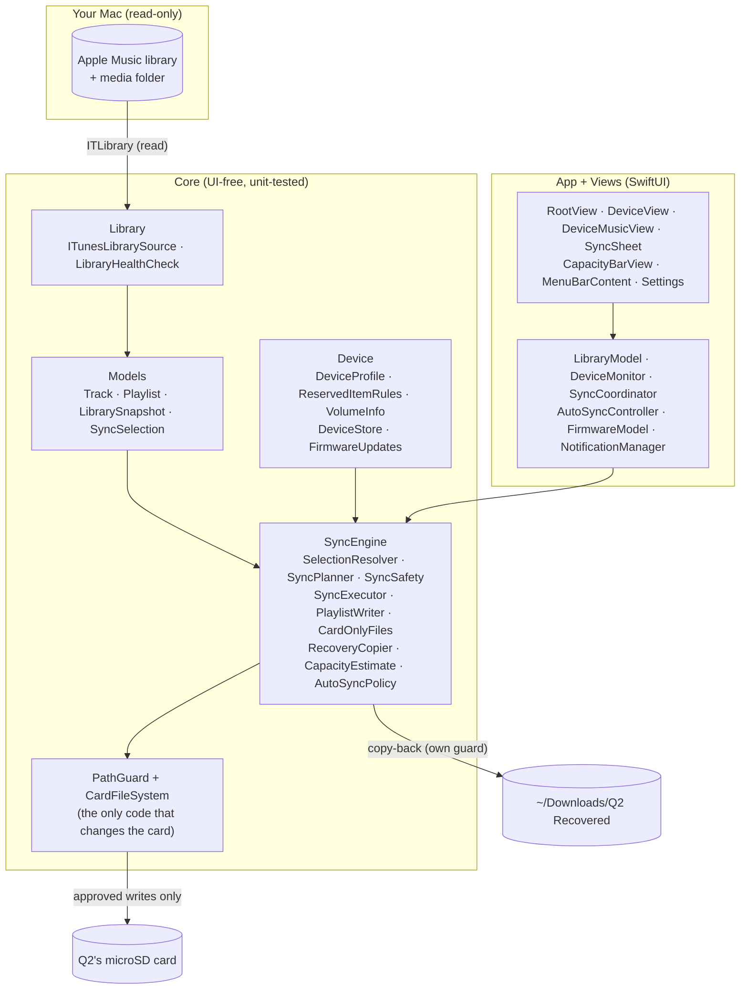
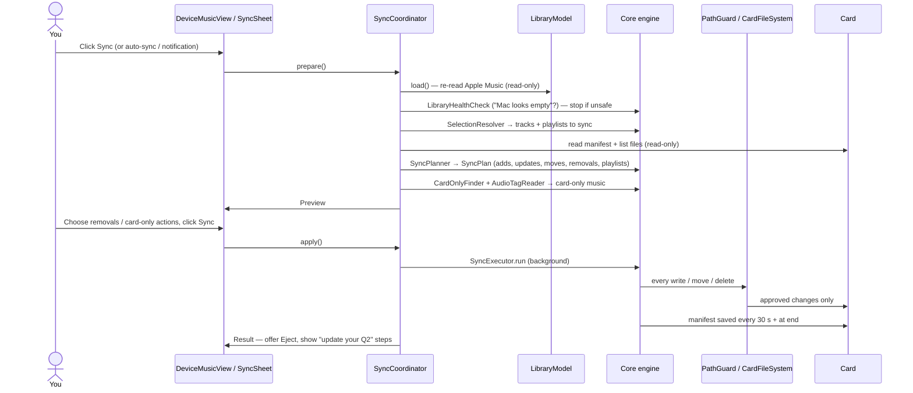

# Q2 Sync — Code Guide and Runbook

This guide explains how Q2 Sync is built: its architecture, how a sync flows,
what every major type does, how device profiles work, the safety design, and
how to build, test and troubleshoot it. It's written for someone new to Swift
and SwiftUI; each source file also starts with a header comment and every type
and function has a `///` doc comment.

> **The rule behind every design decision:** Q2 Sync is strictly **read-only**
> toward your Apple Music library and its media files. The worst acceptable
> failure is a bad sync to the card, which you can fix by syncing again.

---

## Contents

1. [Architecture overview](#1-architecture-overview)
2. [How a sync flows, step by step](#2-how-a-sync-flows-step-by-step)
3. [Major types and functions](#3-major-types-and-functions)
4. [Device profiles (and adding one)](#4-device-profiles-and-adding-one)
5. [Safety design](#5-safety-design)
6. [Build, run and test](#6-build-run-and-test)
7. [Where logs, settings and data live](#7-where-logs-settings-and-data-live)
8. [Troubleshooting](#8-troubleshooting)

---

## 1. Architecture overview

The project has two halves:

- **Core** (`Q2-Sync/Core`) holds all the logic and has **no UI code**. It's
  compiled into the app *and* into a Swift package (`Package.swift`) so it can
  be unit-tested with `swift test`.
- **App + Views** (`Q2-Sync/App`, `Q2-Sync/Views`) hold the SwiftUI interface
  and the glue that connects it to macOS: disk notifications, notifications,
  the menu bar and the login item.



### Folder structure

| Folder | What's in it |
| --- | --- |
| `Q2-Sync/Core/Models` | Plain values: `Track`, `Playlist`, `LibrarySnapshot`, `SyncSelection` |
| `Q2-Sync/Core/Library` | Reading Apple Music: `LibrarySource`, `ITunesLibrarySource` (also `LibraryArtworkReader`, which reads album artwork for covers, read-only), `FixtureLibrarySource`, `LibraryHealthCheck` |
| `Q2-Sync/Core/Device` | Device facts: `DeviceProfile`, `ReservedItemRules`, `VolumeInfo`, `CardConnection`, `DeviceStore`, `FirmwareUpdates`, `FirmwareSources`, `FirmwareImage`, `ZipExtractor` |
| `Q2-Sync/Core/SyncEngine` | Planning, diffing, copying, playlists, path guard, safety |
| `Q2-Sync/App` | App entry point and UI-facing models (`@Observable` classes) |
| `Q2-Sync/Views` | SwiftUI views |
| `Tests/Q2SyncCoreTests` | Unit tests (Swift Testing) for Core |
| `Config/Q2Sync.entitlements` | App Sandbox permissions, each one explained |
| `Scripts/` | `install.sh` (build and install in /Applications), app icon generator |
| `docs/` | This guide, the user guide, and the on-device check list |

### Swift features you'll meet

- **`struct` vs `class`:** almost all Core types are `struct`s (values that are
  copied). The UI models are `final class`es because the whole app shares one
  instance.
- **`@Observable`** (Observation framework): SwiftUI redraws any view that reads
  a property of an `@Observable` class when that property changes.
- **`@MainActor`:** code that touches UI state runs on the main thread; marking
  a class `@MainActor` makes the compiler enforce it.
- **`async`/`await` and `@concurrent`:** slow work (reading the library,
  scanning the card, copying) is `async`. Functions marked `@concurrent` run on
  a background thread, so the window never freezes.
- **`Sendable`:** a promise that a value is safe to pass between threads. Core
  values are `Sendable` so they can move between the UI and background work.
- **Security-scoped bookmarks:** how a sandboxed app keeps permission to a
  folder the user chose (here, the card) across launches. See `DeviceStore`.
- **`@AppStorage`:** a property wrapper that reads and writes a UserDefaults
  value and redraws the view when it changes.

---

## 2. How a sync flows, step by step



1. **Start.** You click **Sync** (`DeviceMusicView`), use the menu bar, or
   auto-sync starts it (`AutoSyncController.startSync`).
2. **Re-read the library.** `SyncCoordinator.prepare` calls `LibraryModel.load`,
   which uses `ITunesLibrarySource` to take a fresh, read-only
   `LibrarySnapshot`. Song file locations (`ITLibMediaItem.location`, a slow
   round trip to the library service per song, which got far slower on each
   re-read in the same run) are remembered across reads by
   `SongLocationCache` while a song's size and date are unchanged. A read
   that takes longer than `LibraryModel.readTimeLimit` (60 s) fails with "isn't
   responding" (`TimeLimit.result` races it; `ITLibrary` can't be cancelled),
   and the sync stops rather than using the previous snapshot. Try Again waits
   on that same read, and if it finishes on its own its result is used.
3. **"Mac looks empty" check.** `LibraryHealthCheck.evaluate` stops the sync if
   the library has no songs, the media folder is missing (e.g. an external drive
   is disconnected), or more than 10% of local files can't be found. Nothing on
   the card is looked at.
4. **Guard.** A `PathGuard` is created for the card. It verifies the card is the
   confirmed, removable, FAT/exFAT volume with the right UUID, and not inside
   `~/Music` or the media folder.
5. **Resolve the selection.** `SelectionResolver.resolve` turns what you ticked
   into tracks to sync, tracks to skip (cloud-only, DRM, missing) and
   playlists.
6. **Read the card.** `SyncManifest.load` reads `.q2sync/manifest.json`;
   `CardScanner.scan` lists the whole card once (reserved items are skipped)
   and `CardScanner.files(in:from:)` takes `Music/` and `_explaylist_data/`
   from that listing. A damaged manifest stops the sync instead of guessing.
7. **Plan.** `SyncPlanner.plan` diffs selection and card: add, update, move
   (rename), adopt (an identical file already there), remove (deselected songs
   Q2 Sync manages), orphaned (songs gone from the library), playlists.
   `PlaylistWriter.dropUnchangedWrites` skips playlists already up to date.
8. **Card-only music.** `CardOnlyFinder.find` lists audio files Q2 Sync doesn't
   manage plus orphaned songs. Files the plan adopts (library songs already on
   the card but not in the manifest, as after an interrupted sync) are not
   card-only and are never offered for moving or deleting. `AudioTagReader.fillTags` reads their tags;
   `CardOnlyFinder.adoptIdenticalCopies` then turns new-song copies into an
   adoption plus a move when an unmanaged file in `Music/` is the same song
   (title, artist, length within 2 s) with exactly the Mac file's size, for
   music copied to the card by hand;
   `CardOnlyFinder.markLibraryMatches` marks ones already in your library.
9. **First sync.** If nothing has been synced to the card yet, the preview
   says so and `AutoSyncPolicy` won't apply it automatically; a sync you
   start yourself can be applied straight from the preview.
10. **Preview.** `SyncPreviewView` shows `SyncPlan.summary(applyRemovals:)`
    (one sentence) and free space, a box for choices (removals, one pop-up per
    `CardOnlyGroup`), and a Details disclosure (`@AppStorage
    "syncPreviewShowsDetails"`, closed by default) with the counts in one box
    per topic (Songs, Not Copied, Playlists, Album Covers) and the lists in the same
    order after the sections that need a choice.
    Removals are **off** until you tick them; card-only files default to
    **Leave**. `SyncSafety.assess` lists blockers (unsafe library, doesn't fit)
    and whether more than 20% would be removed.
11. **Confirm.** Deleting card-only files asks once; removing more than 20% asks
    again.
12. **Apply.** `SyncExecutor.run` (background) works in this order: copy
    card-only files to the Mac → card-only deletes (and moves, once their copy
    worked) → removals → adoptions
    → moves → copies → playlists. Every change goes through `CardFileSystem`,
    which asks `PathGuard` first. The manifest (compact JSON) is saved at most
    every 30 seconds and always at the end, however the sync ends; after a
    crash, songs copied since the last save are adopted by the next sync. A
    log line is written for every change.
13. **Finish.** The result sheet offers **Eject** (never automatic) and shows
    the firmware-specific "update the library on your Q2" steps. On problems,
    the card stays mounted and errors are listed.

---

## 3. Major types and functions

Each entry: **purpose · inputs → outputs · options · side effects**.

### Models (`Core/Models`)

| Type | Purpose | Notes |
| --- | --- | --- |
| `Track` | One song, copied out of Apple Music into a plain value | `availability` says if it can be copied (`available`, `cloudOnly`, `drmProtected`, `fileMissing`, `unsupported`). `effectiveAlbumArtist` mirrors Q2 Pod's album grouping. |
| `Playlist` | One playlist: name, kind (regular/smart/folder), ordered track IDs | Smart playlists are their current contents. |
| `LibrarySnapshot` | Immutable picture of the library | `artistGroups`, `albumGroups`, `genreGroups` build the selection lists, once per snapshot (`memoized`, shared by copies, lock-protected); `groupsByID` looks rows up. `SortKey` sorts like the Q2 (ignores leading The/A/An). |
| `LibraryMarks` | The library browser's marks: per song `TrackPlacement` (on Q2 / next sync / not chosen / can't sync), per group `GroupMarks` counts | Built once per library read, card record and selection (it resolves the selection); compares against `CardContentsRecord`. |
| `SyncSelection` | What you ticked for a device | Stores *intent* (artist/album/genre/playlist IDs) so new albums by a ticked artist sync automatically. |

### Library (`Core/Library`)

- **`LibrarySource`** (protocol) · `loadSnapshot() async throws -> LibrarySnapshot`
  · read-only by design (there is no write method).
- **`ITunesLibrarySource`** · the real library via `ITLibrary`. Keeps songs only
  (no videos, podcasts, audiobooks), skips built-in playlists, checks file
  existence only. Side effects: none; may trigger macOS's "access Apple Music"
  prompt. This is the **only** file that imports `iTunesLibrary`.
- **`FixtureLibrarySource`** · fake library for tests and previews (in code or
  JSON).
- **`LibraryHealthCheck.evaluate(_:) -> LibraryHealth`** · the "Mac looks
  empty" guard. Threshold: `maximumMissingFraction = 0.10`.

### Device (`Core/Device`)

- **`DeviceProfile`** · everything firmware-specific (see section 4).
- **`ReservedItemRules.isReserved(components:) -> Bool`** · decides what the
  app must never touch.
- **`VolumeInfo.read(at:) -> VolumeInfo?`** · reads a volume's UUID, name,
  format, size, removable/internal flags. `bestAvailableCapacity` works around
  exFAT reporting 0 for "important usage".
- **`VolumeEligibility.problem(with:) -> VolumeIneligibility?`** · which disks
  may ever be a Q2: never the startup disk or an internal fixed disk; must be
  removable/ejectable, have a UUID, and be exFAT/FAT.
- **`CardFormatAdvice.check(layout:)`** · warns (never blocks) when a card
  isn't one volume filling a Master Boot Record card, with Disk Utility
  steps: first a scheme that isn't MBR (`check(scheme:)`; erasing fixes the
  rest too), then any other partition of any format or size (a reused
  Raspberry Pi card: small `bootfs` plus a Linux partition; named in the
  message when the volume is `bootfs`/`boot`), then a volume under 97% of
  the card (unused space; a normal card loses only a 1–16 MB alignment gap).
  exFAT and FAT32 are both fine (Shanling supports both). `CardPartitions`
  (scheme, volume and card sizes, other partitions' sizes) comes from
  `DriveIdentityReader.cardLayout`: Disk Arbitration media content and sizes,
  plus every leaf `IOMedia` below the whole disk besides the volume. It's read
  once per mount by `DeviceMonitor`, except through the Q2's USB cable: its
  storage gadget exposes only the volume, as a whole disk, so nothing is read
  there. Unknown never warns. `NewDeviceSheet` shows the warning (Later
  becomes the default button, Continue Anyway stays) and the device page
  shows `CardFormatAdviceSection`.
- **`DeviceStore`** · saves `KnownDevice` records (UUID, name, firmware,
  security-scoped bookmark, selection, auto-sync mode, firmware version,
  first-sync state) and ignored drives to `devices.json` in the app container.
  New fields are optional so older files still load.
- **`CardContentsRecord` / `CardContentsStore`** · a Mac-side note of which
  songs (IDs only) Q2 Sync put on each card, saved whenever `DeviceMonitor`
  reads the card's manifest, so the library browser can mark "On Q2" while
  the Q2 is unplugged. Display only: syncing always uses the card's manifest.
  Deleted when the Q2 is forgotten.
- **`FirmwareUpdateChecker`** · `fetchLatest()` reads GitHub's latest Q2 Pod
  release; `status(latest:installed:dismissedTag:)` decides what to show.
  `FirmwareVersion` parses "1.8.5", "v1.8.5", "V1850". `FirmwareRelease`
  also carries the release's `update.tar` link and GitHub's SHA-256 of it.
- **`CardConnection.classify(_:)`** · from a `DriveIdentity` (USB IDs and
  names, disk vendor/model), tells a Q2 on a USB cable (Ingenic + Linux
  storage gadget) from a card reader. A hint for the UI only, never a safety
  check. Read by `DriveIdentityReader` (App, Disk Arbitration + I/O Kit).
- **`FirmwareSources`** · builds a `FirmwareOffer` from the GitHub release
  (Q2 Pod) or Shanling's download page (stock: version + Google Drive link).
- **`FirmwareImage.inspect(_:)`** · checks an `update.tar`: GNU tar whose
  first entry `firmware_v20.info` says "Shanling Q2" and a version ("V1.36"
  = stock, "V1890" = Q2 Pod 1.8.9). Also `sha256(of:)`.
- **`ZipExtractor.extract(fileNamed:from:to:)`** · takes one file out of a
  zip (stored or deflate), checking size and CRC-32.
- **`PodDataBackup`** · backs up Q2 Pod's data on the card (`items`: ratings,
  scrobbler log, EQ/, …) to a backup folder (default
  `~/Downloads/Q2 Sync Backups`; `BackupFolderSetting` in App keeps a chosen
  one as a security-scoped bookmark, refusing ~/Music and the card), reads
  backups, and lists them. Restore goes through `CardFileSystem.restorePodData`,
  approved by `PathGuard.checkPodDataPath` (only those paths).

### Sync engine (`Core/SyncEngine`)

| Type / function | Inputs → outputs | Side effects |
| --- | --- | --- |
| `SelectionResolver.resolve(_:in:)` | selection + snapshot → `ResolvedSelection` (tracks to sync, skipped, playlists, missing count). Uses the snapshot's cached groups and `tracksInLibraryOrder` (sorted once), so it's cheap enough for every Music-tab redraw; `prepare(_:)` builds those off the main thread right after a library read | none |
| `FilenameSanitizer.sanitizeComponent(_:fallback:maximumBytes:)` / `sanitizeFileName` | text → FAT/exFAT-safe name (NFC, forbidden chars → `_`, trimmed, DOS names, ≤100 UTF-8 bytes) | none |
| `CardLayout.preferredPath(for:)` | track → `Music/<Album Artist>/<Album>/<disc-track> <Title>.<ext>` | none |
| `CardLayout.variant(of:number:)`, `isSameOrVariant`, `caseKey` | name collisions (" (2)"), case-insensitive comparison | none |
| `PathGuard.check(_:for:)` | card path + operation → approved URL, or throws `Violation` | none (checks only) |
| `PathGuard.checkAppleDoubleCompanion(of:)` | managed file → its `._` companion URL | none |
| `PathGuard.checkStrayAppleDouble(_:)` | `._` file in Music/ or the playlist folder → approved URL (AppleDouble signature required) | none |
| `CardFileSystem.removeStrayAppleDoubleFiles()` | end-of-sync sweep of `._` files in Music/ and the playlist folder | deletes those files only |
| `CardFileSystem` | `copyFromMac`, `move`, `removeFile`, `writeAtomically`, `createDirectory`, `removeEmptyFolders`, `removeAppleDoubleCompanion`, `cleanTempFolder` | **the only card writes**, each guarded |
| `SyncManifest.load` / `save` | card ↔ record of managed songs, playlist files, playlist fingerprints and covers (newer fields are optional, so older manifests load) | `save` writes `.q2sync/manifest.json` atomically |
| `PlaylistNaming.disambiguate(_:folders:)` | selected playlists → same-named ones in a folder renamed "Folder - Name" | none |
| `PlaylistImportRule.needsImport(...)` / `digest` | a playlist's bytes + its last fingerprint → whether it goes up for the Q2's Import (only changed playlists stay in `_explaylist_data`) | none |
| `AlbumCovers.plan(tracks:finalPaths:manifest:cardFiles:)` | songs' final paths → `[CoverWrite]` (one `cover.jpg` per album folder; skips folders with the user's own cover/folder image; manifest `albumCovers` records Q2 Sync's) | none |
| `CoverImage.makeJPEG(from:maxPixels:)` | artwork bytes → baseline RGB JPEG ≤ 1000 px (what the Q2 decodes cheaply) | none |
| `TimeRemainingEstimator.update(bytesCopied:totalBytes:at:)` / `describe` | progress samples → seconds left, "About 12 minutes remaining". Counts bytes for music; `forCovers()` counts covers for the album-cover step (`SyncProgress.isAddingCovers`, `coversDone`/`coversTotal`), which has its own bar | none |
| `CardVerifier.verify(manifest:tracks:fileSystem:onProgress:)` / `repairPlan` | managed songs → byte-for-byte comparison with the Mac → `VerifyResult`; failed songs → a copies-only `SyncPlan` | none (reads only) |
| `CardScanner.scan(folder:on:)` / `files(in:from:)` | card folder → files keyed by case-insensitive path (reserved items skipped); `files(in:from:)` takes one top-level folder from a whole-card scan | none |
| `SyncPlanner.plan(...)` | selection + manifest + card listing → `SyncPlan` | none |
| `PlaylistWriter.plan` / `render` / `dropUnchangedWrites` | playlists → file paths and M3U bytes | none |
| `CardOnlyFinder.find` / `markLibraryMatches`, `AudioTagReader.fillTags` | card listing → `[CardOnlyItem]` | reads tags only |
| `SyncSafety.assess(...)` | plan + choices → `SafetyAssessment` (blockers, first sync, >20% removal) | none |
| `SyncExecutor.run(plan:manifest:options:onProgress:)` | plan + choices → `SyncReport` | changes the card (guarded), saves manifest, writes a log; copy-backs via `RecoveryCopier` |
| `RecoveryCopier.copyBack(source:cardPath:)` | card file → copy in `~/Downloads/Q2 Recovered` | writes only inside the staging folder; never overwrites |
| `CapacityEstimate.compute(...)` | sizes + manifest + selection → bar numbers and fit verdict; `cardReadable: false` (no access) → only used and free; `mayIncludeOwnMusic` flags ≥ 1 GB not from Q2 Sync while adding | none |
| `AutoSyncPolicy.decide(plan:assessment:)` | plan → apply / up to date / needs review | none |
| `SyncLog` | writes `Logs/Sync <date>.log` | writes in the app container |

**`SyncOptions`** (the preview's choices): `applyRemovals` (default off),
`largeRemovalConfirmed`, `cardOnlyActions`
(per file: leave, move to Mac, delete; what the executor
reads) and `cardOnlyChoices` (what the preview shows). `CardOnlyChoices` holds
one `GroupChoice` per `CardOnlyGroup` (on card only / not put there by
Q2 Sync / already in library): `.all(action)` or `.individually`, plus per-file
picks kept while a group covers everything. `setCardOnlyChoices(_:items:)`
stores them and recomputes `cardOnlyActions`. `CardOnlyAlbum.group` makes the
preview's album rows (by folder and album tag).

### App (`Q2-Sync/App`)

| Type | Purpose |
| --- | --- |
| `Q2SyncApp` | Entry point: main `Window`, `MenuBarExtra`, `Settings`. `AppDelegate` keeps the app running when the window closes. |
| `LibraryModel` | Loads the snapshot for the UI. Read when the window first shows and when the Q2 connects; never at app launch. |
| `DeviceMonitor` | Watches mounts (NSWorkspace), recognises the Q2 by UUID + bookmark, first-connection flow (`confirm` with an Open panel), eject, per-device settings, card manifest for the capacity bar. |
| `SyncCoordinator` | Sync state machine (idle → planning → preview → running → finished/failed); automatic mode consults `AutoSyncPolicy`. |
| `AutoSyncController` | When the Q2 connects: ask (notification), sync automatically, or nothing; turns outcomes into notifications; firmware checks; tells you about a new Q2 needing setup. Connect and setup notifications are only posted while Q2 Sync isn't in front (`isInFront`, checked 1.5 s after the event so a launching window counts), and notification permission is requested only when one is posted. |
| `NotificationManager` | Posts notifications; handles Sync Now / Eject / Verify Card / Open buttons. |
| `FirmwareModel` | Firmware check state (opt-in, at most daily, cached). |
| `FirmwareInstaller` | Install sheet state and pipeline: find offers, download (`FileDownloader`), unzip, inspect, verify checksum, check free space, `CardFileSystem.placeFirmwareUpdate`, then remember `pendingFirmwareInstall` and ask on the next connection whether the Q2 installed it. |
| `CardVerifyModel` | Verify Card sheet state: check in the background, re-copy failures with `SyncExecutor`. |
| `PodDataModel` | Back Up Now, backups list, restore. |
| `DriveIdentityReader` | Reads a volume's USB/disk identity for `CardConnection`. |

### Views (`Q2-Sync/Views`)

`RootView` (sidebar + detail, sheets), `DeviceView` (header, Music/Settings tabs,
`DeviceSettingsView`), `DeviceMusicView` (selection checkboxes, summary bar),
`CapacityBarView`, `SyncSheet` (`SyncPreviewView`, `SyncProgressView`,
`SyncResultView`), `NewDeviceSheet`, `FirstLaunchNoticeView`,
`FirmwareUpdateSection`, `LibraryCategoryView` + `TrackTableView` (library
browser with "can sync" and "On Q2 / next sync" marks, compared with the
connected Q2 or the one read most recently), `ConnectQ2View` (the sidebar's
"Connect Your Q2" page while no Q2 is connected; selected on first launch),
`OpenAtLoginPrompt` (one line under a Q2's Auto-Sync picker while auto-sync
is on and the app doesn't open at login; `LoginItem` wraps `SMAppService`
for it and `AppSettingsView`'s toggle, the real control),
`SongInspectorView` (the
browser's song inspector; artwork via `LibraryModel.artworkData(for:)`, one
whole-library `LibraryArtworkReader` opened on first use), `LibraryStatusView`, `MenuBarContent`, `AppSettingsView`.

---

## 4. Device profiles (and adding one)

All firmware-specific behaviour lives in `Q2-Sync/Core/Device/DeviceProfile.swift`.
Nothing else in the code mentions a firmware by name.

| Field | Q2 Pod | Stock |
| --- | --- | --- |
| `musicFolderName` | `Music` | `Music` |
| `appStateFolderName` | `.q2sync` | `.q2sync` |
| `playlistFolderName` | `_explaylist_data` | `_explaylist_data` |
| `playlistFormat` | `.m3u`, UTF-8, CRLF, `#EXTM3U`/`#EXTINF`, `/mnt/mmc/…` paths (**unverified**) | same (**unverified**) |
| `maximumPlaylists` / `maximumPlaylistNameBytes` | 100 / 63 | 100 / 63 |
| `reservedItems` | shared list (below) | shared list |
| `libraryUpdateSteps` | Library → Update Library → Scan music now; Library → Playlists → Import | Local Songs → Update Library → Scan music now; Playlists → Import |
| `versionLocationHint`, `deviceMountPoint` | About › "CFW. Version"; `/mnt/mmc` | About; `/mnt/mmc` |

**Reserved items** (`ReservedItemRules`, case-insensitive):

- every hidden (`.`-prefixed) item at any depth, except the app's own `.q2sync`
  at the root. This covers `.rockbox`, `.sldp`, `.coverflow`, `.q2`, `.spotify`,
  `.tidal`, `.photos`, `.books`, `.ratings.tsv`, `.scrobbler.log`, `._*`,
  `.DS_Store`, `.Spotlight-V100`, `.fseventsd`, `.Trashes`;
- at the root: `update.tar`, `update.tar.part`, `recovery-update`, `Q2Pod`,
  `EQ`, `Podcasts`, `Audiobooks`, `Photos`, `Books`, `Videos`, `Radio`,
  `lockscreenimage`, `battery-log.txt`, `System Volume Information`,
  `$RECYCLE.BIN`;
- anywhere: `database.ignore`, `database.unignore`;
- any name containing `librespot`.

### Adding a profile

1. Add a case to `FirmwareKind` (with `displayName` and `profile`).
2. Add a `static let` profile in the `DeviceProfile` extension; reuse
   `sharedReservedRootNames` / `sharedReservedAnywhereNames` and add anything
   the new firmware creates.
3. If its playlists differ, create a new `PlaylistFormat` value.
4. Add the profile to `ReservedItemTests.profiles` in
   `Tests/Q2SyncCoreTests/DeviceTests.swift` so the reserved-item tests run
   against it, and run `swift test`.
5. Document what was verified in `docs/DEVICE_CHECKS.md`.

---

## 5. Safety design

Defence in depth: several independent layers, each enough on its own.

### Layer 1 — App Sandbox (`Config/Q2Sync.entitlements`)

| Entitlement | Why |
| --- | --- |
| `app-sandbox` | Turns the sandbox on. |
| `assets.music.read-only` | **Read-only** access to `~/Music` for ITLibrary and copying. There is deliberately no read-write variant. |
| `files.user-selected.read-write` + `files.bookmarks.app-scope` | Write access to the card you choose once in an Open panel, remembered with a security-scoped bookmark; the same for a Q2 Pod backup folder you choose instead of the default. |
| `files.user-selected.executable` | Stops macOS adding `com.apple.quarantine` to files written to the card (exFAT would store it in `._` companion files that players list as broken songs). |
| `files.downloads.read-write` | "Move to Mac" into `~/Downloads/Q2 Recovered`; Q2 Pod data backups into `~/Downloads/Q2 Sync Backups` (the default backup folder). |
| `network.client` | The optional GitHub firmware check, and firmware downloads you start (GitHub, Shanling's page, Google Drive). |

### Layer 2 — The single PathGuard

Every card change goes through `CardFileSystem`, which calls `PathGuard.check`
first. It resolves symlinks and `..` and refuses anything:

- **(a)** not strictly inside the confirmed card root (the root itself
  included);
- **(b)** on a volume that isn't the confirmed card (wrong UUID, startup disk,
  internal fixed disk, non-removable, non-FAT). Re-checked on **every** call;
- **(c)** under `~/Music` (the real one, not the sandbox container) or the
  Apple Music media folder;
- **(d)** on the reserved-items list.

Plus: normal sync operations only inside `Music/`, `.q2sync/` and
`_explaylist_data/` (only `.m3u` files directly inside); deleting elsewhere
needs `.deleteConfirmedByUser`. The one narrow exception is
`checkAppleDoubleCompanion`, which allows deleting the `._` companion of a song
Q2 Sync manages.

Copy-back has its own guard (`RecoveryCopier.checkDestination`): only inside the
staging folder, never inside `~/Music` or the media folder, never overwriting.

### Layer 3 — Sync rules

- Source files are opened read-only (`FileHandle(forReadingFrom:)`).
- Copies: temp file in `.q2sync/tmp` → flush → size check → keep dates → atomic
  rename.
- "Mac looks empty" guard before planning; a damaged manifest stops planning.
- A card's first sync is never applied automatically.
- Nothing is removed unless you tick it. Removals delete (there's no card
  trash: removed songs are still in the library). Card-only "Move to Mac"
  deletes only after its copy on the Mac is made and size-checked.
- Removing more than 20% of the card's songs needs an extra confirmation, checked
  in the UI and again by the executor.
- Files Q2 Sync didn't put on the card are never overwritten and never removed
  unless you choose so per file; songs gone from your library are offered
  (with "Move to Mac") rather than removed.
- Auto-sync never removes or ejects, and stops for anything needing review.

### Development safety

Tests use temp folders and `FixtureLibrarySource` only. `PathGuard` takes an
injectable `homeMusicFolder` so tests never touch the real `~/Music`. The app
never reads the library at app launch; it reads it when the window first shows
(after the first-launch notice) and when the Q2 connects.

---

## 6. Build, run and test

**Requirements:** macOS 27.2 or later, Xcode 27.2 or later.

**Run the app:** open `Q2-Sync.xcodeproj` in Xcode, select the **Q2-Sync**
scheme and **My Mac**, press ⌘R.

**Install in /Applications:** `Scripts/install.sh` quits a running copy,
builds the Release configuration into `build/Release-DerivedData`, and
replaces `/Applications/Q2 Sync.app`. Use the installed copy day to day (for
auto-sync and Open at login), and avoid running a Debug copy from Xcode at the
same time, as both share the same bundle identifier.

**App icon:** drawn in code by `Scripts/make-app-icon.swift`;
`Scripts/make-app-icon.sh` regenerates every size in
`Q2-Sync/Assets.xcassets/AppIcon.appiconset`.

**Build from Terminal:**

```bash
xcodebuild -project Q2-Sync.xcodeproj -scheme Q2-Sync -configuration Debug -derivedDataPath build/DerivedData build
```

**Run the unit tests** (Core only, about 130 tests, under a second):

```bash
swift test
```

**Signing:** the project signs locally ("Sign to Run Locally",
`CODE_SIGN_IDENTITY = -`). To distribute, set your Development Team in the
target's Signing & Capabilities and use Developer ID signing and notarisation.
With local signing, macOS may ask again for Apple Music access after each
rebuild, and the login item may need approval.

**Project file:** Xcode 27 stores the project as `Q2-Sync.xcodeproj/project.xcproj`
(JSON-style). The app target compiles the whole `Q2-Sync/` folder, so new files
there are picked up automatically.

**Testing with real hardware:** use a throwaway Music library (hold **Option**
while opening Music → **New Library…**) and a spare card. See
`docs/DEVICE_CHECKS.md` for what to verify on a real Q2.

---

## 7. Where logs, settings and data live

Paths on the Mac are inside the app's sandbox container,
`~/Library/Containers/io.github.q2sync.Q2Sync/Data/`:

| What | Where |
| --- | --- |
| Known devices, selections, auto-sync mode, bookmarks | `Library/Application Support/Q2 Sync/devices.json` |
| Each Q2's last known contents (song IDs, dates) for the library browser | `Library/Application Support/Q2 Sync/Card Contents/<volume UUID>.json` |
| Sync logs | `Library/Application Support/Q2 Sync/Logs/` (Settings tab → **Show Sync Logs**) |
| Preferences | `Library/Preferences/io.github.q2sync.Q2Sync.plist`: `acknowledgedLibraryNotice`, `showMenuBarItem`, `checkFirmwareUpdates`, `latestFirmwareRelease`, `lastFirmwareCheck`, `notifiedFirmwareRelease` |
| Copied-back music | `~/Downloads/Q2 Recovered/` with `RECOVERED.txt` |
| Q2 Pod data backups | `<backup folder>/<card> <date>/` (default `~/Downloads/Q2 Sync Backups`; a chosen folder's bookmark is `podBackupsFolderBookmark` in UserDefaults) with `backup.json` and `About this backup.txt` |
| Firmware downloads | a temporary folder, deleted after copying to the card |
| Diagnostics | Console.app, subsystem `io.github.q2sync.Q2Sync` (counts only, no song names or paths) |

On the card:

| What | Where |
| --- | --- |
| Synced music | `Music/<Album Artist>/<Album>/<disc-track> <Title>.<ext>` |
| Playlists | `_explaylist_data/<Name>.m3u` |
| Manifest | `.q2sync/manifest.json`: managed songs (`entries`), playlist files (`playlistFiles`), playlist fingerprints for quick imports (`playlistDigests`), Q2 Sync's album covers (`albumCovers`) |
| Album covers (optional) | `Music/<Album Artist>/<Album>/cover.jpg` |
| Firmware waiting to install | `update.tar` at the card root |
| Temp files | `.q2sync/tmp/` (cleaned every sync) |

---

## 8. Troubleshooting

| Symptom | Cause and fix |
| --- | --- |
| "Couldn't open your Apple Music library" | Allow Q2 Sync in System Settings › Privacy & Security › Media & Apple Music. With local signing this may reset after rebuilding. |
| "Library appears to have no songs" / "media folder isn't available" | The "Mac looks empty" guard: connect the external music drive, or check the right library is open in Music. |
| Card never shows up | It must be exFAT/FAT, removable, with a UUID. Check Disk Utility. If you clicked **Not My Q2**, use Settings (⌘,) → **Ask Again About Drives Marked “Not My Q2”**. |
| "no longer has permission to use this card" | Settings tab → **Grant Access…**, select the card root. |
| "The selected music doesn't fit" | Deselect music, or allow removals in the preview. The app keeps 200 MB free. |
| "record of this card is damaged" | `.q2sync/manifest.json` is corrupt. Delete it; the next sync re-adopts identical files and copies the rest. |
| `._` files on the card | Made by macOS (Finder copies or quarantine). Q2 Sync removes them next to its own songs; for others run `dot_clean -m /Volumes/<card>/Music`. |
| Songs don't appear on the Q2 | On the Q2, run Update Library (see the result sheet's steps). |
| Playlists don't import | Check `_explaylist_data/` on the card and the format notes in `docs/DEVICE_CHECKS.md`. |
| Auto-sync doesn't start | Q2 Sync must be running (menu bar), the Q2's setting must be **Ask** or **Sync Automatically**, and notifications allowed. |
| Firmware check fails | Needs internet; GitHub rate-limits anonymous requests (60/hour). Try later. |
| Tests fail on a fresh clone | Run `swift test` from the repository root (where `Package.swift` is). |

## Performance notes

- **Library groupings** (artists, albums, genres, playlists) and the
  library's song order are worked out once per `LibrarySnapshot`
  (`memoized`), off the main thread right after a read
  (`SelectionResolver.prepare`).
- **Music tab:** `MusicTabCache` keeps the resolved selection and the
  capacity estimate until the selection, library or card changes; the
  ticked set is built once per redraw.
- **Selection saves** are debounced (0.5 s after the last click);
  `DeviceMonitor.flushPendingSave()` saves at once before a sync, on
  disconnect and when the app quits.
- **The card's manifest** is read in the background (`reloadManifest`),
  and a read that finishes after the card changed is dropped.
- **Card scans:** one whole-card listing per plan; `ReservedItemRules`
  keeps its lowercased name sets from `init`, as it's checked per file.
- **Sync:** the manifest is saved every 30 s (not every 25 songs), and each
  album cover is made inside its own autorelease pool.

